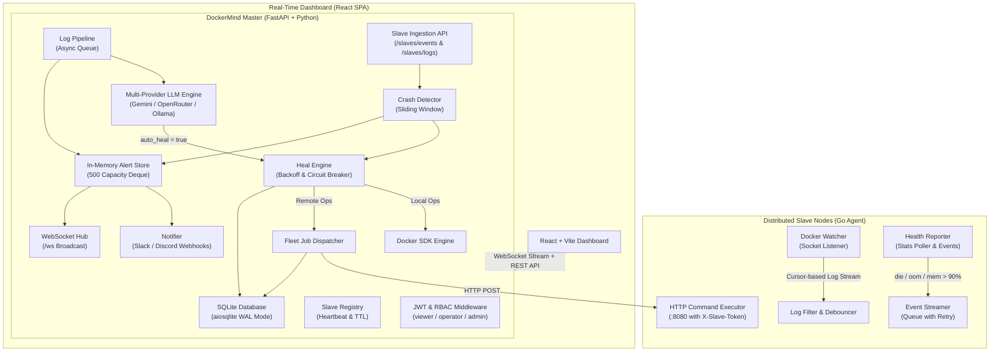

# DockerMind — Autonomous AI Site Reliability & DevOps Agent

**DockerMind** is a self-hosted, autonomous AI Site Reliability Engineering (SRE) and DevOps platform built for Docker environments. It combines distributed host telemetry, Docker daemon event streaming, and local or cloud LLMs (Google Gemini, OpenRouter, and Ollama) to automatically monitor, diagnose, alert, and heal containerized workloads across multi-node clusters.

---

## 🚀 What is DockerMind?

Modern containerized applications fail in complex ways: silent memory leaks triggering the Linux Out-Of-Memory (OOM) killer, cascading crash loops, database connection pool exhaustion, and misconfigured entrypoints. Typically, resolving these requires on-call engineers to wake up, SSH into remote hosts, run `docker logs`, dig through megabytes of stacktraces, and manually restart services.

**DockerMind automates this entire incident lifecycle:**
1. **Listens:** Lightweight Go agents (Slaves) attached to Docker sockets continuously monitor container events and sample memory/CPU usage.
2. **Filters & Streams:** The agents intelligently filter logs for anomalies and stream error batches with high-water mark cursor tracking to the Master.
3. **Diagnoses:** The Master LLM pipeline assesses the logs, determines the exact root cause, assigns a severity (`ok`, `warn`, `error`, `critical`), and proposes an actionable remediation plan.
4. **Auto-Heals:** If safe to heal, DockerMind executes automated remediation (restart, start, stop, or exec commands) with built-in **exponential backoff** and **circuit breaker** protection.
5. **Alerts & Audits:** Immediate, rich notifications are pushed to Slack and Discord, events are broadcast via WebSockets to connected dashboards, and every automated action is preserved in an immutable SQLite audit log.

---

## 💡 How DockerMind Improves Operational Quality & Uptime

| Operational Problem | Traditional Approach | DockerMind Solution |
| :--- | :--- | :--- |
| **Silent OOM Kills** | Container disappears with exit code 137; unnoticed until users report downtime. | Docker event watcher immediately detects OOM kills and high memory usage (>90%), alerts Slack with exact MB telemetry, and restarts the container safely. |
| **Infinite Crash Loops** | Broken service restarts hundreds of times per minute, exhausting host CPU and filling disk logs. | Sliding-window crash detector tracks restarts; auto-heal enforces exponential backoff (10s → 30s → 60s → 120s → 300s) and a **circuit breaker** halts restarts after 5 failed attempts. |
| **Noisy Log Triage** | Engineers spend 30–60 minutes parsing 10,000 log lines to find the single root cause. | LLM analysis pipeline extracts the core failure, formats root cause and recommended fix, and presents it in seconds. |
| **Multi-Host Management** | SSH into 5 different servers to run container maintenance or collect logs. | **Multi-Slave Fleet Command Dispatch** allows operators to trigger actions across `all` nodes or targeted tag groups simultaneously. |
| **Cascading Outages** | Automated reboot loops thrash dependencies. | Cooldown tiers and circuit breakers isolate persistent failures and request manual intervention before cluster stability is compromised. |

---

## 🏛️ System Architecture



---

## 📂 Codebase Breakdown & Components

### Master Node (`master/`)
- **`main.py`**: FastAPI application entrypoint. Initializes database, seeds runbooks, mounts WebSocket hub (`/ws`), registers routers, and exposes container lifecycle endpoints.
- **`config.py`**: Centralized configuration loader for ports, database paths, LLM provider settings, and API secrets.
- **`database.py`**: SQLite database interface powered by `aiosqlite`. Automatically configures `aiosqlite.Row` factories, WAL journal mode, and manages tables for `jobs`, `runbooks`, and `audit_log`.
- **`docker_ops.py`**: Direct Docker SDK wrapper on the Master host (container list, inspect, logs, restart, start, stop, exec).
- **`llm_client.py`**: Multi-provider LLM client with intelligent fallback:
  - **Online Mode:** Google Gemini (`gemini-2.5-flash`) as primary, automatically falling back to OpenRouter (`gemma-4-26b`) if rate-limited or quota is exceeded.
  - **Local Mode:** Self-hosted Ollama (`qwen2.5-coder:1.5b`) for air-gapped/offline setups.
  - Parses and guarantees structured JSON schema output (`severity`, `root_cause`, `fix`, `auto_heal`, `heal_action`).
- **`slave_registry.py`**: In-memory registry tracking slave node heartbeats, IP addresses, online/offline status, tags, and container counts.
- **`middleware/auth.py`**: JWT Bearer token authentication and Role-Based Access Control (`viewer`, `operator`, `admin`) with bcrypt password verification.
- **`routers/`**:
  - `auth.py`: Login, token generation, user creation, and current user profile.
  - `slaves.py`: Public ingestion endpoints for slave registration, heartbeats, logs, events, multi-slave fleet dispatch (`POST /slaves/dispatch`), and circuit-breaker reset.
  - `alerts.py`: Query alerts by severity/container, unhealed alerts, crash-loop summaries, and alert acknowledgment.
  - `jobs.py`: Scheduled job creation, status tracking, cancellation, and audit log inspection.
  - `logs.py`: Container log retrieval and on-demand LLM log analysis.
  - `runbooks.py`: Declarative automated runbook creation, execution, and listing.
- **`services/`**:
  - `log_pipeline.py`: Asynchronous queue for processing log batches received from slaves, running LLM evaluations, populating alerts, notifying webhooks, and executing auto-heals.
  - `crash_detector.py`: Tracks container deaths in a 5-minute sliding window, calculates crash frequencies, detects crash loops, and identifies exit code signatures.
  - `heal_engine.py`: Healing execution with **Exponential Backoff** (`10s → 30s → 60s → 120s → 300s`) and **Circuit Breaker** (max 5 retries). Executes local operations or dispatches to remote slaves.
  - `job_dispatcher.py`: Executes scheduled jobs and runs parallel multi-slave fleet operations using `asyncio.gather()`.
  - `scheduler.py`: Background job scheduler polling pending jobs in SQLite every 10 seconds.
  - `notifier.py`: Dispatches rich webhook alerts to Slack and Discord.

### Slave Agent (`slave/`)
- **`main.go`**: Agent entrypoint. Discovers outbound network IP, handles persistent registration with the Master, starts workers, and handles graceful shutdown.
- **`docker_watcher.go`**: Connects to the host Docker socket (`/var/run/docker.sock`). Maintains active container inventory, tracks high-water mark log timestamps to avoid re-sending duplicate logs, and pre-filters logs using anomaly keywords.
- **`health_reporter.go`**: Real-time event watcher listening to Docker engine events (`die`, `oom`, `start`, `stop`). Samples container CPU and memory stats, detects memory limit breaches (>90%), and immediately dispatches recent logs when a container dies.
- **`event_streamer.go`**: Non-blocking queued event forwarder with exponential retry (up to 3 attempts) ensuring critical events reach the Master even during network blips.
- **`executor.go`**: HTTP server listening on port `8080`. Accepts and executes commands sent from Master (`restart`, `start`, `stop`, `exec`, `logs`, `containers`) secured by `X-Slave-Token`.
- **`grpc_client.go`**: HTTP/mTLS communication client with automatic reconnection and re-registration on master reboot.

---

## ⚙️ Configuration & Setup

### 1. Requirements
- Docker & Docker Compose installed.
- Ports `8000` (Master API) and `8080` (Slave Agent) open.
- Optional: Gemini API key for online AI analysis (or Ollama for local offline mode).

### 2. Environment Variables (`.env`)

```ini
# Security & JWT Auth
JWT_SECRET=my-super-secure-jwt-key-32chars
JWT_EXPIRE_HOURS=24
ADMIN_PASSWORD=admin123

# Pre-seeded users (format: username:password:role,...)
USERS=admin:admin123:admin,uday:test123:operator,uday2:test123:viewer

# LLM Provider Configuration
LLM_PROVIDER=online
GEMINI_API_KEY=your_gemini_api_key_here
GEMINI_MODEL=gemini-2.5-flash

# Fallback Provider
OPENROUTER_API_KEY=your_openrouter_api_key_here
OPENROUTER_MODEL=google/gemma-4-26b-a4b-it:free

# Master Server Settings
MASTER_HOST=0.0.0.0
MASTER_PORT=8000
API_SECRET=dockermind-dev-secret
DB_PATH=/app/data/dockermind.db

# Notifications (Slack & Discord)
SLACK_WEBHOOK_URL=https://hooks.slack.com/services/...
DISCORD_WEBHOOK_URL=
NOTIFY_MIN_SEVERITY=error
```

### 3. Quick Start

```bash
# 1. Generate mTLS certificates
bash scripts/gen_certs.sh

# 2. Build and start containers
docker compose up -d --build

# 3. View logs
docker compose logs -f master
```

---

## 📡 API Reference & Endpoints

Interactive Swagger UI documentation is available at **`http://localhost:8000/docs`**.

### 1. Authentication (`/auth`)
| Method | Endpoint | Access | Description |
| :--- | :--- | :--- | :--- |
| `POST` | `/auth/login` | Public | Authenticates credentials and returns JWT Bearer token |
| `GET` | `/auth/me` | Viewer+ | Returns current user subject, role, and expiration |
| `GET` | `/auth/users` | Admin | Lists all configured users and their roles |
| `POST` | `/auth/users` | Admin | Creates a new user |
| `DELETE`| `/auth/users/{username}` | Admin | Deletes a user |

### 2. Slave Management & Ingestion (`/slaves`)
| Method | Endpoint | Access | Description |
| :--- | :--- | :--- | :--- |
| `GET` | `/slaves` | Viewer+ | Lists all registered slave nodes and status |
| `POST` | `/slaves/register` | Public (Agent) | Registers a new slave node |
| `POST` | `/slaves/heartbeat` | Public (Agent) | Receives heartbeat and container count |
| `POST` | `/slaves/logs` | Public (Agent) | Ingests container logs into async LLM pipeline |
| `POST` | `/slaves/events` | Public (Agent) | Ingests `die`, `oom`, and `health_fail` events |
| `GET` | `/slaves/crash-loops`| Viewer+ | Lists containers currently in active crash loops |
| `GET` | `/slaves/pipeline/stats` | Viewer+ | Returns log pipeline queue and processed stats |
| `POST` | `/slaves/dispatch` | Operator+ | Dispatches fleet commands across multiple/all slaves |
| `POST` | `/slaves/circuit-breaker/reset` | Operator+ | Clears backoff delay and resets circuit breaker |
| `DELETE`| `/slaves/{slave_id}`| Admin | Deregisters a slave node |

### 3. Container Management (`/containers` & `/logs`)
| Method | Endpoint | Access | Description |
| :--- | :--- | :--- | :--- |
| `GET` | `/containers` | Viewer+ | Lists containers across host with live status |
| `GET` | `/containers/{name}/logs` | Viewer+ | Retrieves recent log lines for a container |
| `POST` | `/containers/{name}/restart` | Operator+ | Restarts a local container |
| `POST` | `/containers/{name}/start` | Operator+ | Starts a stopped container |
| `POST` | `/containers/{name}/stop` | Operator+ | Stops a running container |
| `POST` | `/containers/exec` | Admin | Executes an arbitrary shell command in a container |
| `GET` | `/logs/{container_name}/analyze` | Operator+ | Triggers real-time LLM log analysis |

### 4. AI & Auto-Healing (`/heal` & `/chat`)
| Method | Endpoint | Access | Description |
| :--- | :--- | :--- | :--- |
| `POST` | `/heal` | Operator+ | Fetches logs, queries LLM, and triggers auto-heal |
| `POST` | `/chat` | Viewer+ | Conversational DevOps assistant prompt |

### 5. Alerts & Incident Management (`/alerts`)
| Method | Endpoint | Access | Description |
| :--- | :--- | :--- | :--- |
| `GET` | `/alerts` | Viewer+ | Lists incident alerts with filter by severity/container |
| `GET` | `/alerts/unhealed` | Viewer+ | Lists unhealed critical and error alerts |
| `GET` | `/alerts/crash-summary` | Viewer+ | Overview of active crash loops and alert counts |
| `POST` | `/alerts/{id}/acknowledge` | Operator+ | Acknowledges and silences an alert |

### 6. Scheduled Jobs & Audit Trail (`/jobs`)
| Method | Endpoint | Access | Description |
| :--- | :--- | :--- | :--- |
| `POST` | `/jobs` | Operator+ | Schedules a background or recurring maintenance job |
| `GET` | `/jobs` | Viewer+ | Lists jobs and execution status |
| `GET` | `/jobs/{id}` | Viewer+ | Retrieves specific job execution result |
| `DELETE`| `/jobs/{id}` | Operator+ | Cancels a pending job |
| `GET` | `/jobs/audit/log` | Admin | Full historical audit log of all system actions |

### 7. WebSocket Live Feed (`/ws`)
- Real-time streaming connection transmitting:
  - `init`: Full node and container inventory upon connection.
  - `slave_status`: Periodic node heartbeat changes.
  - `container_lifecycle_event`: Instant death, start, stop, or OOM occurrences.
  - `alert`: LLM diagnosis, severity badges, and recommended remediation.
  - `auto_heal`: Healing execution outcome and backoff status.
  - `stats_update`: Real-time CPU and Memory utilization per container.

---

## 🎨 Task 5: Real-Time React Dashboard (Architecture & Design Plan)

The next step is building the **DockerMind Real-Time React Dashboard**.

### UI Architecture & Tech Stack
- **Framework:** React 18+ with Vite (blazing fast HMR, production bundle).
- **Styling:** Modern Dark-Theme DevOps aesthetic (Glassmorphism, Tailwind CSS, Lucide Icons).
- **State & Real-Time:** Native WebSocket connection to `ws://master:8000/ws` with automatic reconnection, synchronized with REST API queries.

### Dashboard Views & Components
1. **Cluster Overview Bar:**
   - Active Slaves (Online/Offline badges, Host IP, Tags).
   - Cluster-wide Container Counts (Running, Stopped, Crash-Looping).
   - Active Alerts Summary (Critical, Error, Warn).
2. **Container Telemetry Fleet Grid:**
   - Card/Table view of containers across local and remote nodes.
   - Real-time CPU% and Memory% progress bars (dynamic amber warning at >80%, red pulse at >90%).
   - One-click Quick Actions: Restart, Stop, Start, Stream Logs, Trigger Auto-Heal.
3. **Live Log Stream & LLM Diagnostic Console:**
   - Terminal-style streaming log viewer.
   - AI Analysis Card: Displays Severity Badge, Detected Root Cause, Suggested Remediation, and Auto-Heal Trigger status.
4. **Incident & Backoff Command Center:**
   - Active Crash Loops panel displaying restart counts, backoff delay timer, and circuit-breaker status.
   - One-click "Reset Circuit Breaker" and "Acknowledge Alert" buttons.
5. **Fleet Command Dispatch Modal:**
   - Interface to dispatch actions (`restart`, `stop`, `exec`, `log_check`) across multiple slave nodes simultaneously with aggregate response badges.
