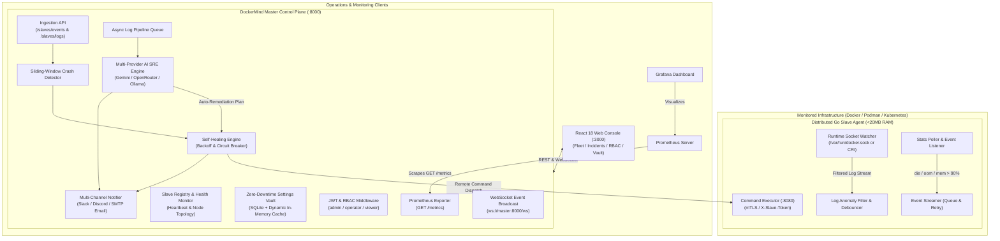

# DockerMind — Autonomous AI Site Reliability & DevOps Agent

<div align="center">


[](https://golang.org)
[](https://python.org)
[](https://fastapi.tiangolo.com)
[](https://react.dev)
[](https://docker.com)
[](https://prometheus.io)
[](https://grafana.com)
[](LICENSE)

**Self-hosted, autonomous AI Site Reliability Engineering (SRE) and DevOps platform for Docker, Podman, and Kubernetes clusters.**

[Deploy in 1 Minute](DEPLOYMENT_GUIDE.md) • [Architecture](#-system-architecture) • [Web Console](#-real-time-react-web-console) • [Prometheus & Grafana](#-prometheus--grafana-monitoring) • [API Reference](#-api-endpoints-reference)

</div>

---

## 🚀 What is DockerMind?

Modern containerized applications fail silently and unpredictably: memory leaks triggering Linux Out-Of-Memory (OOM) kills, cascading crash loops, exhausted database connection pools, and unhandled panics. Resolving these traditionally requires on-call engineers to wake up at 3 AM, SSH into remote hosts, sift through megabytes of stacktraces, and manually restart services.

**DockerMind automates the entire incident lifecycle from detection to root-cause diagnosis, autonomous remediation, and alerting:**

1. **Continuous Telemetry & Event Streaming:** Lightweight Go agents (Slaves) attached to container runtime sockets continuously stream container events (`die`, `oom`, `health_status`), sample True RSS memory, and capture log anomalies with high-water mark cursor tracking.
2. **AI-Powered Root-Cause Analysis:** The Master LLM pipeline (Google Gemini, OpenRouter, or Local Ollama) parses error bursts, strips noise, isolates the core failure, assigns a severity rating, and drafts an actionable remediation plan in seconds.
3. **Autonomous Self-Healing with Circuit Breakers:** If auto-healing is safe, DockerMind executes automated container recovery (restart, stop, start, or custom command) protected by **exponential backoff** (10s → 30s → 60s → 120s → 300s) and a **circuit breaker** to prevent infinite reboot loops.
4. **Multi-Channel Alert Dispatching:** Instant incident summaries are delivered to **Slack**, **Discord**, and **Email (SMTP)** with direct links to the web console.
5. **Zero-Downtime Settings Vault:** Rotate AI API keys, switch LLM models, and reconfigure notification webhooks directly from the Web Console without restarting containers.
6. **Enterprise RBAC Directory:** Persistent SQLite-backed user management with granular permission roles (`admin`, `operator`, `viewer`).
7. **Prometheus & Grafana Native:** Built-in `/metrics` exporter endpoint and a pre-configured Grafana dashboard template for end-to-end cluster observability.

---

## 🏛️ System Architecture



---

## ⚡ Quickstart: 1-Line Universal Installer

DockerMind provides a self-contained POSIX bootstrapper that provisions the entire Master control plane or connects distributed edge slaves with zero manual configuration.

### Deploy the Master Control Plane

Run the bootstrapper on your master server:

```bash
curl -fsSL https://raw.githubusercontent.com/dockermind/dockermind/main/install.sh | bash
```

*Or within a cloned repository:*
```bash
bash install.sh
```

- **Interactive Prompts:** Configures your admin password, generates high-entropy `JWT_SECRET` and `API_SECRET` tokens, sets up mTLS certificates, and lets you choose your AI provider.
- **Default Credentials:** If you leave the password blank or deploy headlessly, DockerMind sets:
  - **Username:** `admin`
  - **Password:** `admin` *(Identical to the Grafana convention).*
- **Web Console:** Accessible immediately at `http://<SERVER_IP>:3000`.

---

### Connect Distributed Edge Slaves

Once the Master starts, it automatically prints the exact 1-line command to connect your worker nodes:

```bash
curl -fsSL https://raw.githubusercontent.com/dockermind/dockermind/main/install.sh | bash -s -- \
  --role slave \
  --master http://<MASTER_HOST>:8000 \
  --secret <YOUR_API_SECRET> \
  --node-id node-worker-01
```

The Go agent connects, handshakes with the Master, and appears in the Web Console within 3 seconds.

> 📖 **Need step-by-step production instructions?**  
> Check the comprehensive [Production Deployment & Operations Guide](DEPLOYMENT_GUIDE.md) for Podman rootless setup, Kubernetes DaemonSet deployment, backup routines, and firewall rules.

---

## 🖥️ Real-Time React Web Console

DockerMind features a dark-themed DevOps web console built with **React 18**, **Vite**, **Tailwind CSS**, and **Lucide Icons**:

### 1. Fleet & Containers
- Real-time CPU% and True RSS Memory% progress bars (dynamic amber warning at >80%, pulsing red alert at >90%).
- Real-time container state badges (`running`, `exited`, `paused`, `restarting`).
- One-click container actions: **Restart**, **Start**, **Stop**, **Stream Logs**, and **Trigger AI Analysis**.

### 2. Incidents & Alerts
- Real-time timeline of detected crashes, OOM events, and log anomalies.
- AI Root-Cause Diagnostic Cards: Explains the exact failure mechanism, severity rating, and recommended solution.
- One-click alert acknowledgment and incident resolution.

### 3. Fleet Command Dispatch
- Multi-host command orchestrator allowing operators to execute maintenance actions (`restart`, `stop`, `exec`, `log_check`) across multiple or all slave nodes simultaneously.

### 4. Metrics & Prometheus
- Cluster overview gauges: Active Nodes, Healthy vs. Crashing Containers, Memory Utilization, and Active Incidents.
- Direct links to Prometheus `/metrics` and Grafana dashboard templates.

### 5. Users & RBAC Management
- Administrator-only user directory.
- Create new users, assign granular roles (`admin`, `operator`, `viewer`), reset passwords, and revoke access with persistent SQLite backing.

### 6. Integrations & Settings Vault
- **Zero-Downtime AI Key Rotation:** Switch between Google Gemini, OpenRouter, and Ollama and rotate API keys without container restarts.
- **Multi-Channel Notification Center:** Configure Slack incoming webhooks, Discord channels, and corporate SMTP/Gmail relays with instant diagnostic test pings.

---

## 📊 Prometheus & Grafana Monitoring

DockerMind includes a native Prometheus exporter serving metrics in standard exposition format (`text/plain; version=0.0.4`):

- **Endpoint:** `http://<MASTER_IP>:8000/metrics`
- **Dashboard Template:** [`monitoring/grafana/dockermind-dashboard.json`](monitoring/grafana/dockermind-dashboard.json)
- **Scraper Config:** [`monitoring/prometheus/prometheus.yml`](monitoring/prometheus/prometheus.yml)

### Key Metrics Exported:
| Metric Name | Type | Description |
| :--- | :---: | :--- |
| `dockermind_up` | Gauge | Master service operational status (1 = healthy). |
| `dockermind_slaves_total{status}` | Gauge | Total registered edge slaves (`online` vs `offline`). |
| `dockermind_containers_total{node, status}` | Gauge | Total containers by status (`running`, `exited`, `paused`). |
| `dockermind_container_memory_rss_bytes{node, container}` | Gauge | **True RSS memory** consumption (inactive page cache subtracted). |
| `dockermind_container_cpu_usage_pct{node, container}` | Gauge | Real-time container CPU utilization percentage. |
| `dockermind_crashloop_active{node, container}` | Gauge | Active crash loop indicator (1 = crashing, 0 = stable). |
| `dockermind_circuit_breaker_active{node, container}` | Gauge | Circuit breaker status halting restart thrashing. |
| `dockermind_healing_actions_total{action, status}` | Counter | Cumulative automated healing actions executed. |
| `dockermind_alerts_active_total{severity}` | Gauge | Active alerts grouped by severity (`critical`, `error`, `warn`). |

---

## ☸️ Multi-Runtime Support (Docker, Podman, Kubernetes)

| Runtime | Deployment Method | Capabilities | Status |
| :--- | :--- | :--- | :---: |
| **Docker Engine** | Standard container / `install.sh` | Full lifecycle event watching, log streaming, and container self-healing. | `Production Ready` |
| **Docker Swarm** | Swarm manager overlay | Service discovery, task-level health monitoring, multi-node dispatch. | `Supported` |
| **Podman** | System or Rootless user socket | Auto-detects `/run/podman/podman.sock` & rootless user sockets. | `Supported` |
| **Kubernetes** | Light Agent `DaemonSet` | Kubelet/CRI socket monitoring, `CrashLoopBackOff` & `OOMKilled` pod watcher. | `Active Phase 3` |

---

## 🔌 API Endpoints Reference

### Authentication & Users (`/auth`)
| Method | Endpoint | Access | Description |
| :--- | :--- | :--- | :--- |
| `POST` | `/auth/login` | Public | Authenticates credentials and returns JWT bearer token. |
| `GET` | `/auth/users` | Admin | Lists all user accounts and assigned roles. |
| `POST` | `/auth/users` | Admin | Creates a new user account with bcrypt hashing. |
| `PUT` | `/auth/users/{username}` | Admin | Updates user role or resets password. |
| `DELETE`| `/auth/users/{username}` | Admin | Removes a user account (safeguarded against root admin deletion). |

### Distributed Slave Fleet (`/slaves`)
| Method | Endpoint | Access | Description |
| :--- | :--- | :--- | :--- |
| `GET` | `/slaves` | Viewer+ | Lists all registered slave nodes with health status and tags. |
| `POST` | `/slaves/register` | Agent | Registers a new slave node with cluster secret. |
| `POST` | `/slaves/heartbeat` | Agent | Ingests periodic slave heartbeat and node metrics. |
| `POST` | `/slaves/logs` | Agent | Streams container log lines into the async AI triage pipeline. |
| `POST` | `/slaves/events` | Agent | Ingests container `die`, `oom`, and `health_status` events. |
| `GET` | `/slaves/crash-loops` | Viewer+ | Lists containers currently in active crash loops. |
| `POST` | `/slaves/dispatch` | Operator+ | Dispatches fleet commands across targeted or all nodes. |
| `POST` | `/slaves/circuit-breaker/reset` | Operator+ | Resets backoff counter and unblocks circuit breaker. |
| `DELETE`| `/slaves/{slave_id}` | Admin | Deregisters a decommissioned slave node. |

### Container Management (`/containers`)
| Method | Endpoint | Access | Description |
| :--- | :--- | :--- | :--- |
| `GET` | `/containers` | Viewer+ | Lists containers across the cluster with live status and True RSS. |
| `GET` | `/containers/{name}/logs` | Viewer+ | Retrieves recent container log lines. |
| `POST` | `/containers/{name}/restart` | Operator+ | Restarts a container on the local node. |
| `POST` | `/containers/{name}/start` | Operator+ | Starts a stopped container. |
| `POST` | `/containers/{name}/stop` | Operator+ | Stops a running container. |
| `POST` | `/containers/exec` | Admin | Executes a remote command inside a container. |

### AI SRE Engine & Auto-Healing (`/heal`, `/chat`, `/logs`)
| Method | Endpoint | Access | Description |
| :--- | :--- | :--- | :--- |
| `GET` | `/logs/{container_name}/analyze` | Operator+ | Manually triggers AI root-cause analysis on recent logs. |
| `POST` | `/heal` | Operator+ | Executes AI log analysis and triggers automated remediation. |
| `POST` | `/chat` | Viewer+ | Conversational AI DevOps assistant query. |

### Incidents & Alerts (`/alerts`)
| Method | Endpoint | Access | Description |
| :--- | :--- | :--- | :--- |
| `GET` | `/alerts` | Viewer+ | Lists incident alerts with filter by severity and container. |
| `GET` | `/alerts/unhealed` | Viewer+ | Returns active unhealed incidents. |
| `GET` | `/alerts/crash-summary` | Viewer+ | Summarizes active crash loops and alert counts. |
| `POST` | `/alerts/{id}/acknowledge` | Operator+ | Acknowledges and silences an active alert. |

### Zero-Downtime Settings Vault (`/settings`)
| Method | Endpoint | Access | Description |
| :--- | :--- | :--- | :--- |
| `GET` | `/settings` | Admin | Returns current configuration with masked secrets. |
| `PUT` | `/settings/ai` | Admin | Hot-reloads AI provider (`gemini`, `openrouter`, `ollama`) and API keys. |
| `POST` | `/settings/ai/test` | Admin | Tests AI connectivity and response latency. |
| `PUT` | `/settings/notifications` | Admin | Updates Slack, Discord, and SMTP email settings. |
| `POST` | `/settings/notifications/test` | Admin | Sends diagnostic test alert to all configured channels. |

### Observability & Streaming (`/metrics` & `/ws`)
| Method | Endpoint | Access | Description |
| :--- | :--- | :--- | :--- |
| `GET` | `/metrics` | Public | Standard Prometheus metric exposition scraper endpoint. |
| `WS` | `/ws` | Public/JWT | Real-time WebSocket event feed streaming node status, alerts, and stats. |

---

## 🔒 Security Architecture
- **Password Protection:** Passwords hashed with standard `bcrypt` before persistence.
- **Zero-Downtime Secret Masking:** Sensitive keys (`GEMINI_API_KEY`, `JWT_SECRET`, `API_SECRET`) are masked in REST API responses (`AIza...******...YXCg`) and kept in protected SQLite storage.
- **mTLS Inter-Node Security:** Edge slaves communicate with the Master using mutual TLS certificates generated via `scripts/gen_certs.sh`.
- **Role-Based Access Control:** Every endpoint is gated by fine-grained permissions (`viewer`, `operator`, `admin`).

---

## 📄 License
DockerMind is released under the **MIT License**. Feel free to use, modify, and distribute in commercial and private environments.
